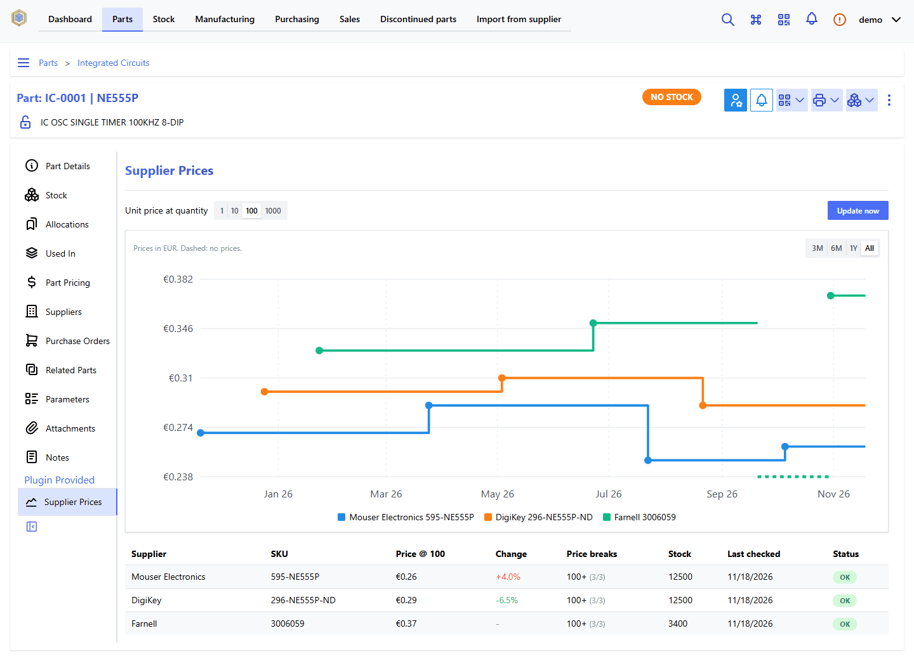
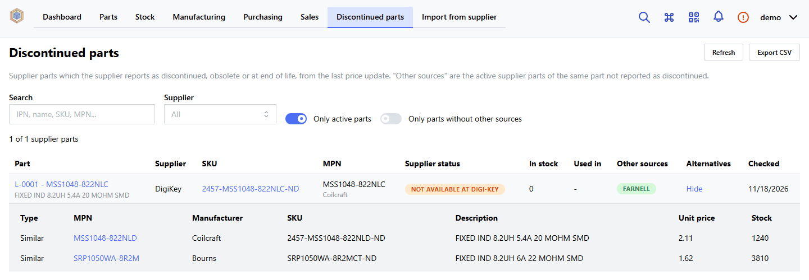

# inventree-part-pricing-update

[InvenTree](https://inventree.org) plugin (>= 1.0) that keeps the **supplier part prices** up to date from **Mouser**,
**DigiKey** and **Farnell** and records their **history**, shown as a chart on the part page.

Unlike [inventree-supplier-panel](https://github.com/SergeoLacruz/inventree-supplier-panel) it does not create carts
or import parts: it only takes care of the prices. Parts can be imported with the companion plugin
[inventree-supplier-part-import](https://github.com/Kamaar/inventree-supplier-part-import), which uses this plugin.

## Screenshots

**Supplier Prices** panel on the part page: price history at the selected quantity (the dashed segment is a period
without prices), current prices, change, price breaks, stock and status of each supplier.



**Discontinued parts** page: the supplier parts reported as discontinued, with the other active sources and the
alternatives suggested by the supplier.



## Features

- Background updates (scheduled task every 15 minutes, in small batches, within the API limits).
- Replaces the price breaks of the supplier part with the supplier ones and updates the availability (both optional).
  InvenTree then recalculates the part pricing.
- Price history: a new record is created only when the prices change; while they stay the same, only the `last_seen`
  date of the last record is updated.
- **Supplier Prices** panel on the *Part* and *Supplier Part* pages:
  - a chart of the unit price at the selected quantity (1 / 10 / 100 / 1000). Each price is valid until a different
    one replaces it, up to the last check. Periods 3M / 6M / 1Y / All, dates on day, week or month boundaries.
    Periods without prices (e.g. product no longer sold) break the line and are dashed at the bottom. All suppliers are
    shown in the InvenTree base currency, converted with the current InvenTree exchange rates; a supplier without an
    exchange rate is listed apart;
  - a table with the current price, the change from the previous price, the price break used for the quantity, the
    stock, the last check and the status;
  - the **Update now** button.
- Section in the plugin settings page with the status of each supplier, the latest errors and **Update all now**.
- **Discontinued parts** page (navigation menu, `/web/plugin/part-pricing-update/discontinued`): the supplier parts
  reported as discontinued, with the stock of the part, the assemblies using it, the other active suppliers, the
  suggested code and the alternatives of the supplier. Filters by supplier, text, active parts and parts without other
  sources; CSV export.

## Installation

The plugin is on [PyPI](https://pypi.org/project/inventree-part-pricing-update/):

- **from the InvenTree UI** (*Settings → Plugins → Install plugin*): *Package Name* `inventree-part-pricing-update`;
- **or with `plugins.txt`** (InvenTree data folder): a line `inventree-part-pricing-update`.

With *Check plugins on startup* enabled, a restart installs the latest version. Otherwise run `invoke plugins`, as below.

It can also be installed from this repository with a **version tag** of the
[releases](https://github.com/Kamaar/inventree-part-pricing-update/releases) (without a tag pip does not download new
commits): `inventree-part-pricing-update @ git+https://github.com/Kamaar/inventree-part-pricing-update@vX.Y.Z`.

With Docker, install in **both** the server and the worker container, then restart them: different versions in the
two processes cause the *Plugin Registry Mismatch* error (INVE-E20).

```bash
docker compose exec inventree-server invoke plugins
docker compose exec inventree-worker invoke plugins
docker compose restart inventree-server inventree-worker
```

`invoke plugins` installs from `plugins.txt` and copies the frontend files (`collectplugins`). After an update, reload
the browser page.


### First start

In *Settings → Plugins* enable:

- **Enable app integration** (tables of the price history);
- **Enable URL integration** (API of the panel);
- **Enable schedule integration** (automatic updates);
- **Enable interface integration** (panel and pages).

Then activate **Part Pricing Update**, restart server and worker and run the migrations (`invoke migrate`; the Docker
image runs them at startup with `INVENTREE_AUTO_UPDATE=True`).

Check that server and worker have the same version:

```bash
docker compose exec inventree-server pip show inventree-part-pricing-update | grep Version
docker compose exec inventree-worker pip show inventree-part-pricing-update | grep Version
```

## Configuration

| Setting | Notes |
|---|---|
| `MOUSER_API_KEY` | Key of the Mouser *Search API* (not the cart API key) |
| `DIGIKEY_CLIENT_ID` / `DIGIKEY_CLIENT_SECRET` | *Production* DigiKey app subscribed to **Product Information V4** |
| `DIGIKEY_SITE` / `DIGIKEY_LANGUAGE` / `DIGIKEY_CURRENCY` | Default `IT` / `en` / `EUR` |
| `FARNELL_API_KEY` | element14 *Product Search API* key |
| `FARNELL_STORE` | Default `it.farnell.com`; the store also sets the currency |

The keys are *protected* settings: once saved they are not shown again. The same credentials of
[Ki-nTree](https://github.com/sparkmicro/Ki-nTree) can be used (`~/kintree/user/*_api.yaml`).

**DigiKey** uses the OAuth *2-legged* flow (client credentials): no browser login, so it works from the background worker.

### Suppliers

`MOUSER_SUPPLIER`, `DIGIKEY_SUPPLIER` and `FARNELL_SUPPLIER` link each API to a supplier company in InvenTree. When empty,
the plugin uses a supplier whose name contains `mouser`, `digikey`/`digi-key` or `farnell`/`element14`/`newark`.

Only **active** supplier parts with a **SKU** are updated. The SKU must be the supplier code, e.g. `595-NE555P` (Mouser),
`296-1411-5-ND` (DigiKey), `3006059` (Farnell).

- Placeholder SKUs (`N/A`, `-`, `TBD`, `?`, `none`…) are ignored and use no requests.
- Farnell re-reel codes (e.g. `2913817RL`) not found are looked up with the base code, which has the same unit prices.
- **Renumbered codes**: when the SKU does not exist any more, the plugin looks up the MPN of the linked manufacturer part
  (DigiKey, Mouser, Farnell). The prices are read from the new code, shown with the *New code* badge; update the SKU by hand.
- **End of life**: statuses like `Obsolete`, `Discontinued`, `Last Time Buy`, `Not For New Designs`, `End of Life`,
  `NO_LONGER_STOCKED` are treated as discontinued. The panel shows the alternatives suggested by the supplier
  (DigiKey `substitutions`, Mouser `SuggestedReplacement` and alternate packagings).
- **Removed from the catalog**: when neither the SKU nor the MPN exist any more, the status becomes
  *Not available at Mouser / Digi-Key / Farnell* (two independent codes not found: a typo is unlikely). Without an MPN
  it stays a plain "not found" error.
- **Not sold in your region** (Mouser): a status, not an error.
- **No price in this packaging**: an active product sold only in another packaging (e.g. DigiKey, not stocked, price
  only for the full reel and not for the cut tape of the SKU) is a status with a yellow badge; the packagings with a
  price are listed as alternatives and the current prices are kept.
- `CLEAR_UNAVAILABLE_PRICES` (default on): when the supplier reports the product as discontinued without prices, the price
  breaks are removed and the availability set to 0, so that InvenTree does not use stale prices. The prices are saved
  in the history first, also the ones entered by hand.
- Discontinued products are not errors: the panel shows the status badge, the summary counts them apart
  ("3 updated, 1 discontinued"). To stop checking them, deactivate the supplier part.
- **Temporary errors** (HTTP 5xx, network): the supplier is not queried any more in that run and its parts stay due, so
  they are checked again 15 minutes later instead of after `UPDATE_INTERVAL_DAYS`.
- The extra requests (MPN and keyword searches, alternatives) count in the quota.

### Request limits

| API | Indicative limits |
|---|---|
| Mouser | 30 requests/minute, 1000/day |
| DigiKey | 120 requests/minute, 1000/day |
| Farnell | 2 requests/second, 1000/day |

The requests sent to each API are counted per UTC day (*Supplier API Usage* table) and never exceed the configured limit:

- `MOUSER_DAILY_LIMIT`, `DIGIKEY_DAILY_LIMIT`, `FARNELL_DAILY_LIMIT` (default **800**): leaves a margin for other tools
  using the same keys (e.g. Ki-nTree).
- **Spread over the day**: each run (every 15 minutes) gets at most `requests left today / runs left today` per supplier,
  so the quota does not run out in the first hours and **Update now** keeps working.
- `PARTS_PER_RUN` (default 20): maximum requests per supplier in a single run.
- **Per-minute limits**: minimum pause between two requests to the same API (Mouser 2.1 s, DigiKey and Farnell 0.6 s);
  the suppliers are interleaved, so the pauses overlap.
- **Quota errors from the APIs** (Mouser `TooManyRequests`, Farnell `Developer Over Rate`, DigiKey 429 with a long
  `Retry-After`): the supplier is paused until UTC midnight; per-minute limits pause it for `Retry-After` (or 60 s).
- Manual updates (**Update now**) count in the quota too.
- `UPDATE_INTERVAL_DAYS` (default 7): each supplier part is checked at most once every N days.
- `MAX_RUN_SECONDS` (default 60): maximum duration of a run, below the worker timeout (`INVENTREE_BACKGROUND_TIMEOUT`).

With 800 requests a day and a 7 day interval, about 5600 supplier parts per supplier stay up to date. **Update all now**
marks all the supplier parts as due: the scheduled task processes them in batches.

## API

All the endpoints are below `/plugin/part-pricing-update/`:

| Method | Endpoint | Description |
|---|---|---|
| GET | `part/<id>/` | Current prices, status and history of the supported supplier parts of a part |
| POST | `part/<id>/` | Update the supplier parts of the part now |
| GET / POST | `supplierpart/<id>/` | Same, for a single supplier part |
| GET | `discontinued/` | Discontinued supplier parts, with stock, BOM usage and other sources |
| GET | `status/` | Summary per supplier and latest errors (staff only) |
| POST | `status/` | Mark all the supplier parts as due (staff only) |

Permissions are the ones of the supplier prices in InvenTree (*Purchase Order* role, *Supplier Price Break* model):

- *Supplier Prices* panel, prices and history: view permission (`company.view_supplierpricebreak`);
- **Update now** and updates through the API: change permission (`company.change_supplierpricebreak`);
- *Discontinued parts* page: view permission on supplier parts (`company.view_supplierpart`); the prices of the
  alternatives are shown only with the price permission.

Staff users always have access. The history is also visible in the Django admin (*Price Records*, *Pricing Status*).

## API for other plugins

`part_pricing_update.api` is the stable interface for other plugins (e.g. inventree-supplier-part-import). The rest of
the package may change; `API_VERSION` increases only with incompatible changes.

```python
from part_pricing_update import api

if api.is_available():
    client = api.get_client('digikey')          # requests counted in the daily quota
    results = client.search('NE555P')           # keyword search
    details = client.details('296-NE555P-ND')   # MPN, category, parameters, datasheet, image, prices
    others = api.get_client('mouser').find_by_mpn(details.mpn)
    api.apply_quote(supplier_part, details.quote)  # prices, availability and history
```

When the daily quota is used up, the client raises `api.QuotaExceededError` before sending the request.

`ProductDetails.rohs` and `ProductDetails.reach` hold the RoHS / REACH status with the same values for every supplier
(in Italian, as saved by the import plugin):

- RoHS: `Conforme (RoHS3)`, `Conforme`, `Conforme (con esenzione)`, `Non conforme`, `Non applicabile`;
- REACH: `Conforme (nessuna SVHC)`, `Conforme (nessuna SVHC al <date>)`, `Contiene SVHC`, `Contiene SVHC: <substances>`,
  `Non applicabile`.

For Farnell, `rohsCompliant` plus `rohsPhthalatesCompliant` gives `Conforme (RoHS3)` (directive 2015/863 adds the
4 phthalates). `DigiKeyClient.environmental_documents(sku)` returns the RoHS / REACH declarations of the manufacturer
(one request).

## Development

```bash
uv sync                 # .venv with pytest, ruff, requests
uv run pytest           # supplier clients, on recorded API responses
uv run ruff check part_pricing_update tests
cd frontend && npm install && npm run lint && npm run build
```

**Integration tests** on a real InvenTree (migrations, price updates, part pricing, permissions, pages) are in
`tests/integration`. They need a migrated InvenTree and, besides the database variables, `INVENTREE_SRC` (the
`src/backend/InvenTree` folder), `INVENTREE_PLUGINS_ENABLED=True`, `INVENTREE_PLUGIN_TESTING=True`,
`INVENTREE_PLUGIN_TESTING_SETUP=True` and `INVENTREE_PLUGINS_MANDATORY=part-pricing-update`:

```bash
python -m pytest tests/integration    # with the Python of the InvenTree environment
```

Every test runs in a transaction which is rolled back. In CI they run on the `inventree/inventree:stable` image; a
weekly scheduled pipeline catches the changes of new InvenTree releases.

Code style: Ruff (Python) and Biome (frontend, `biome.json`); `pip install pre-commit && pre-commit install` runs them
at every commit. LF line endings (`.gitattributes`, `.editorconfig`).

Plugin metadata: `PLUGIN_VERSION` and `PLUGIN_DATE` in `__init__.py`, updated at every release.
`MAX_VERSION = '1.99.99'`: on a new major InvenTree version the plugin is not loaded until it has been checked (it has
its own tables and migrations, `AppMixin`).

`tools/digikey_diagnose.py` shows the raw DigiKey responses for a product, with the credentials saved in the plugin
(instructions in the file header).

### Release

1. Update `PLUGIN_VERSION` / `PLUGIN_DATE` in `part_pricing_update/__init__.py` and `version` in `frontend/package.json`.
2. Commit, tag `vX.Y.Z`, push and publish a GitHub release: the `publish.yml` workflow uploads the package to PyPI
   (Trusted Publishing, no token). `tools/check_version.py` checks that a tag matches `PLUGIN_VERSION`.

The frontend (React + Mantine, provided by InvenTree at runtime) is in `frontend/` and is built into
`part_pricing_update/static/` with hashed file names. The built files are committed, so `pip install git+…` works
without Node; run `npm run build` after every frontend change.

### Structure

```
part_pricing_update/
  core.py          # plugin class: settings, scheduled task, URLs, UI panels and pages
  api.py           # public API for other plugins
  pricing.py       # update logic (Django)
  suppliers/       # Mouser / DigiKey / Farnell clients (no Django)
  models.py        # PriceRecord (history), PricingStatus (last check / error), SupplierApiUsage (quota)
  quota.py         # daily quota spread over the runs (no Django)
  views.py         # REST endpoints of the frontend
  migrations/
  static/          # built frontend
frontend/src/
  Panel.tsx        # Supplier Prices panel
  PriceChart.tsx   # SVG chart of the history
  Settings.tsx     # section of the plugin settings page
  Discontinued.tsx # Discontinued parts page
tests/             # unit tests; tests/integration on a real InvenTree
```

## Credits

- **[inventree-supplier-panel](https://github.com/SergeoLacruz/inventree-supplier-panel)** (SergeoLacruz): the idea of
  an InvenTree panel with supplier data. No code is reused.
- **[Ki-nTree](https://github.com/sparkmicro/Ki-nTree)** (sparkmicro and contributors): reference for the supplier APIs
  and the credentials. The clients are written from scratch.
- **[InvenTree](https://inventree.org)**: [plugin documentation](https://docs.inventree.org/en/stable/plugins/) and
  frontend structure from the [plugin-creator](https://github.com/inventree/plugin-creator) template (MIT).
- Supplier APIs: [Mouser Search API](https://www.mouser.com/api-search/),
  [DigiKey Product Information v4](https://developer.digikey.com/),
  [element14 Product Search API](https://partner.element14.com/). Mouser, DigiKey, Farnell and element14 are trademarks of
  their owners.

## License

MIT, see [LICENSE](LICENSE).
